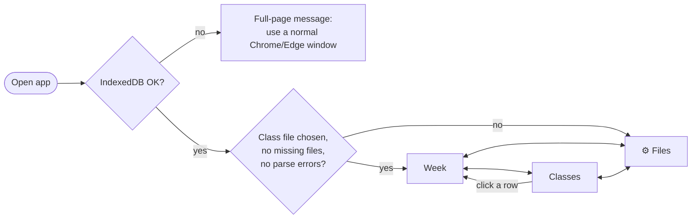
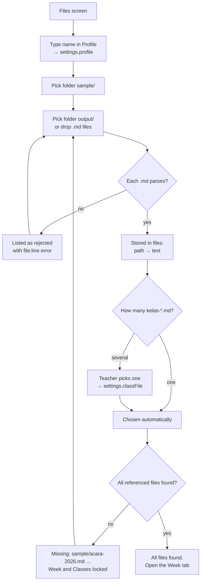
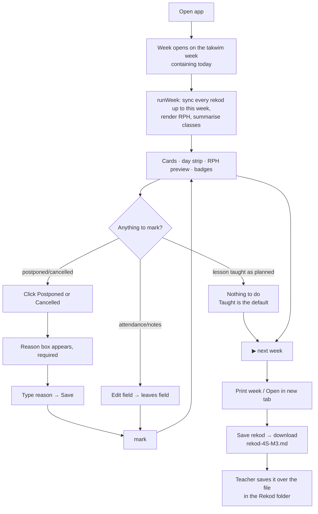
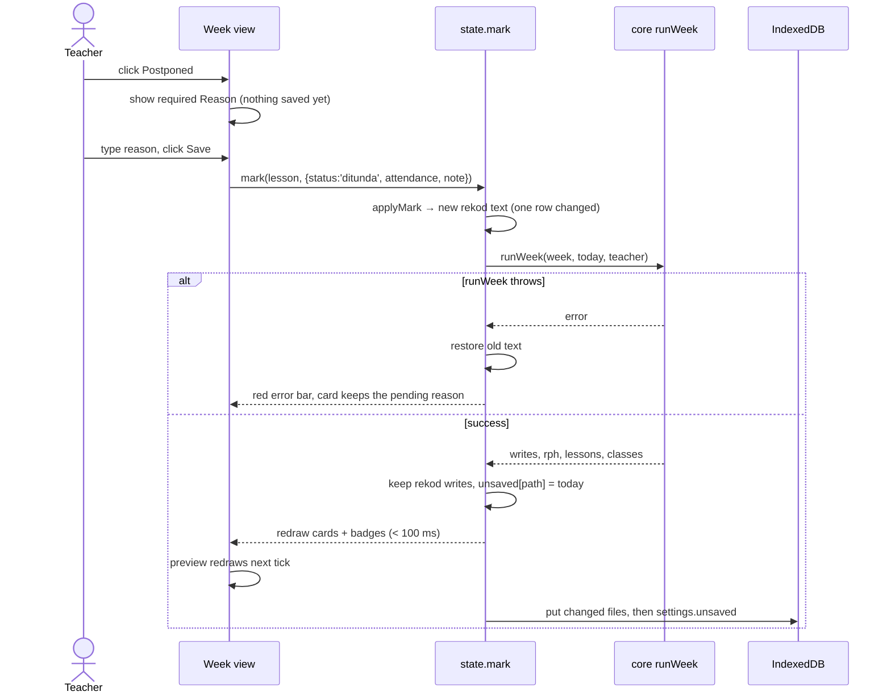
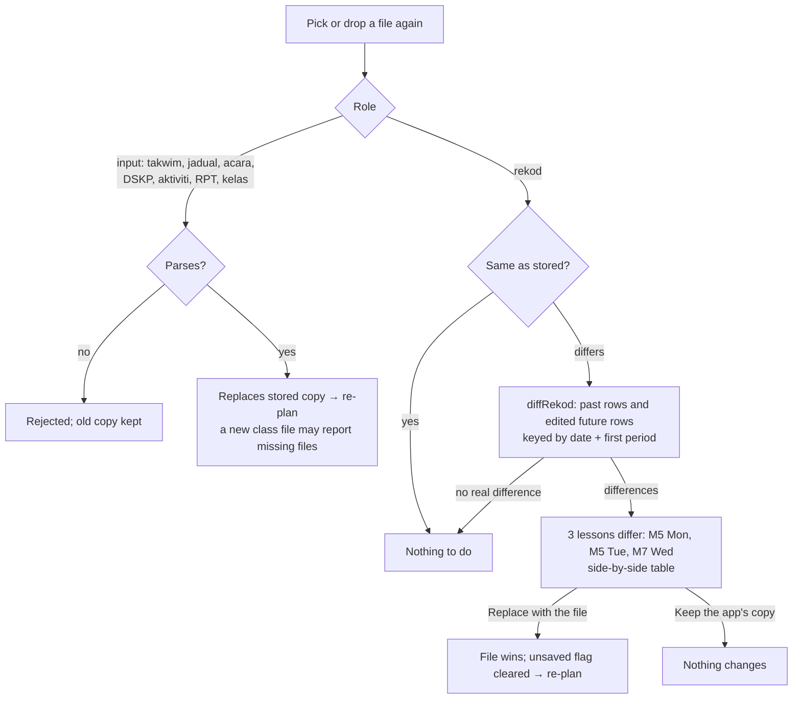

# RPH Mate — App Flow

_2026-10-25 · How the teacher moves through the app, and how data moves behind each step. Screens: [UI/UX brief](ui-ux-brief.md). Data: [backend-schema.md](backend-schema.md). Flowcharts use Mermaid (rendered on GitHub)._

Status: everything in §1–§6 is **Built, unchecked** (Phase 1). §7 is **Planned**.

---

## 1. Screen map

- Three tabs: **Week**, **Classes**, **⚙ Files**. Until setup is complete, every tab shows Files.
- The top bar is always visible: app name · ◀ Week *n* (dates) ▶ · Today · tabs · one position badge per class · Unsaved changes · Save rekod.

## 2. First run (setup)

Notes
- Only `.md` files are read; PDFs, DOCX and HTML in the folders are ignored.
- References in the class file (Takwim, Jadual, Acara, DSKP, Aktiviti, RPT) resolve against the class file's folder. A dropped file without a folder matches by name when the name is unique.
- A missing **rekod** file is not an error: the first run creates it.
- No name in Profile → NAMA GURU stays blank and the Files screen says so.

## 3. Weekly loop (the main flow)

Typical session (laptop, end of week):
1. Open the app. It lands on this week.
2. For lessons that didn't happen as planned, choose **Postponed** or **Cancelled** and type the reason. Fix attendance where it differs from the class size.
3. Watch the following lessons' SPs move ("← SPs moved since last view") and the badge update.
4. **▶** to next week, check the cards, **Print week** (or Open in new tab → print to PDF).
5. **Save rekod** once per changed file, and save each download over the old rekod file.

## 4. Marking a lesson (detail)

Rules shown in this flow
- **Taught** applies at once. **Postponed / Cancelled** wait for a non-empty reason.
- Editing Attendance or Notes commits when the field loses focus (change event) and goes through the same `mark` path.
- Marking a **future** lesson is allowed (for example, cancelling ahead for an event). A changed Status or Catatan keeps that row through future runs.
- A **postponed** lesson keeps its RPH page with "PdP ditunda kerana: <reason>"; its SPs move to the next lesson. A **cancelled** lesson has no page; its SPs also move.

## 5. Re-picking files

## 6. Edge flows

| Situation | What the teacher sees | What happens |
|---|---|---|
| Today isn't in the takwim (school break, another year) | Top bar: "Today is not in the 2026 takwim" | Opens on the last week shown; navigation still works |
| A week with no lessons for any class | "No lessons this week." | Holidays listed in the day strip |
| Every lesson in the week cancelled | "No RPH pages this week." | No HTML for that subject and week |
| Exam day for the class's form | Grey card "Exam: PAT TING. 4", no buttons | Lesson is in the rekod with a blank Status; SP doesn't advance |
| Persistent storage refused | Yellow banner: "This browser may clear the app's data…" | App works; the teacher must Save rekod often |
| Unsaved for more than 7 days | "● Unsaved changes" turns red | — |
| Private window / no IndexedDB | Full-page message | App doesn't start |
| `runWeek` error after an input change | Red bar above the cards | Result cleared until the input is fixed |

## 7. Planned flows

### 7.1 Release (developer, Phase 1b)
`node test/all.js` → `node tools/release.js ../rph-mate` → review the printed file list → commit and push in `rph-mate` → GitHub Pages serves `https://falhaindrubin.github.io/rph-mate/` → open in Chrome → Install → reload offline to check.

### 7.2 History import (Phase 2)
Files → **Import history** → pick an exported Sheet (CSV) per subject → preview the matched lessons (week, date, SP, status) → confirm → rows are merged into the rekod as past rows → the Progress view fills.

### 7.3 Drive sync (Phase 3)
Files → **Connect Google Drive** → Google sign-in (narrow scope) → first sync uploads the local store, or downloads it if one already exists → after that: on open, on each change (debounced) and on reconnect → a status chip in the top bar (Synced · Offline · Syncing · Conflict resolved). On a second device: open the app → Connect → download → ready, without picking any folders.

### 7.4 Yearly setup (Phase 4, December–January)
New takwim and class file → per subject: AI drafts `kesukaran-*.md` outside the app → in the app: **RPT** tab → Generate → review the week table → **Freeze** → weekly planning reads the frozen snapshot. Regenerating later shows a diff and needs confirmation.

### 7.5 Timetable change (any time; works today through file re-pick)
Convert the new aSc printout to `jwg-<date>.md` with its effective-from date → add it to the class file's `Jadual:` line → re-pick both → every future untouched lesson moves to the new slots; past lessons and edited rows stay; a kept future row whose slot disappeared is warned about.
